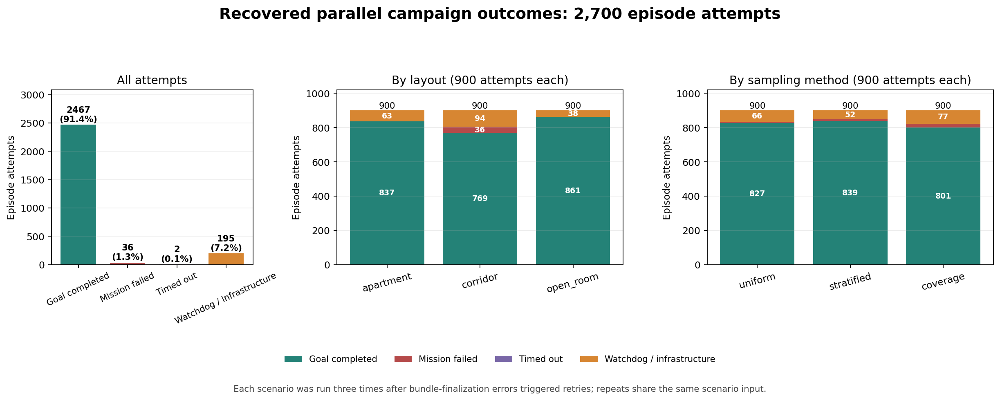
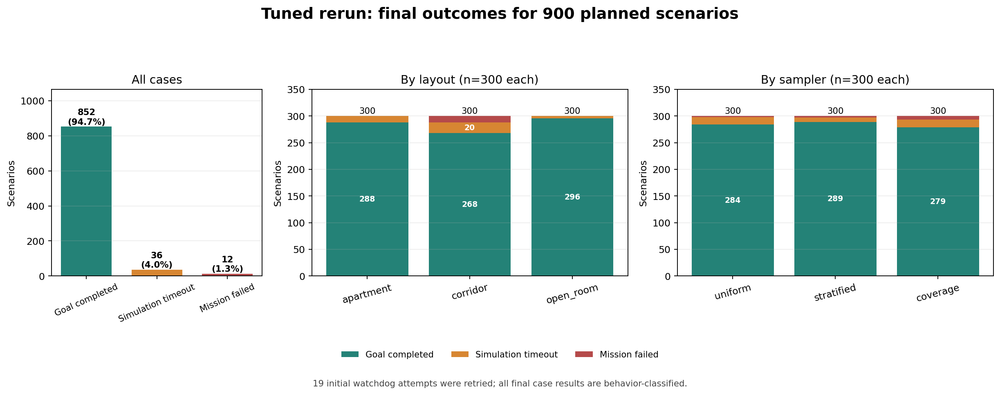
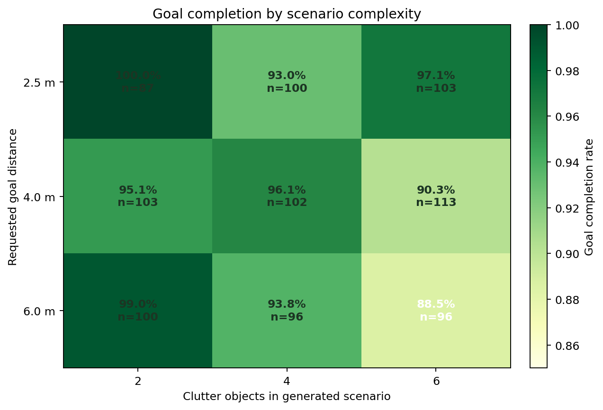

# EnvFuzz project brief for advisor feedback

**Prepared November 17, 2026**
**Purpose:** summarize implementation phases and preliminary experimental evidence; request guidance on the next research question.

## Project summary

EnvFuzz is a ROS 2 Jazzy / Gazebo Harmonic framework for testing indoor robot navigation under controlled changes to the simulated environment. It provides scenario generation, repeatable missions, Nav2 integration, telemetry, oracles, replay, and parallel Docker workers. The project aims to fuzz capabilities of existing navigation code, so experiments need to configure the capability under study and use outcomes that distinguish expected behavior from a regression.

## Phase status

| Phase | Status in project checklist | Scope and evidence |
|---|---:|---|
| **1 — MVP** | 29/29 tasks checked | CPU-only headless simulation, deterministic scenario compilation, calibration, scoring, seeded obstacle fuzzing, and durable run bundles. The Phase 1 seed-42 experiment completed 20/20 goals, with zero scored events. |
| **2 — Navigation benchmark** | 15/15 tasks checked | Parallel campaigns, uniform/stratified/coverage-guided sampling, map diagnostics, timed edits, replay/minimization, reports, and classroom evaluation. An eight-worker benchmark reached 9.68 behavior episodes/min on an eight-CPU VM. |
| **3 — Simulation hardening** | 11/20 tasks checked | Scripted actors, material and sensor fixtures, motion/contact/cliff observations, robot profiles, AMCL, and classroom guidance. The remaining checklist includes replay/coverage acceptance, alternative-backend comparison, GPU camera verification, and release work. |

The project status and detailed records are in [progress](progress.md), [Phase 1 verification](phase-1-verification.md), [Phase 2 verification](phase-2-verification.md), and [Phase 3 verification](phase-3-verification.md).

## November parallel campaign results

The campaign planned 900 generated scenarios: 100 per layout/sampler cell across apartment, corridor, and open-room layouts and uniform, stratified, and coverage sampling. Sixteen Docker workers ran the batch. The container produced results, but the host initially could not rename the root-owned output folders into place. That packaging error triggered two retries per case, so the recovered data contains **2,700 actual episode attempts**: three runs of each of the 900 generated scenarios. These are repeated attempts on the same scenario, not 2,700 independent scenarios.

The bundles were recovered by copying each preserved container output into its canonical attempt folder. All 2,700 attempt bundles are now indexed, and host-side finalization errors were retained in each bundle for audit. The recovered attempt-level data is [attempt-results-recovered.csv](../runs/parallel-coverage-100-20261111/attempt-results-recovered.csv); [results.csv](../runs/parallel-coverage-100-20261111/results.csv) summarizes the last attempt for each planned scenario. The original failure-only summary remains available as [results-host-finalization-failures.csv](../runs/parallel-coverage-100-20261111/results-host-finalization-failures.csv). The campaign plan is in [the campaign directory](../runs/parallel-coverage-100-20261111/), and its manifest is [parallel-coverage-100.yaml](../examples/parallel-coverage-100.yaml).

| Attempt outcome | Count | Share of all 2,700 attempts |
|---|---:|---:|
| Goal completed | 2,467 | 91.4% |
| Mission failed | 36 | 1.3% |
| Timed out | 2 | 0.1% |
| Watchdog / infrastructure | 195 | 7.2% |

Among the 2,505 behavior-classified attempts, 2,467 reached the goal (98.5%). Completed runs had a median path length of 3.87 m. Every recovered result had score 0, no recorded oracle events, and no baseline hash, so these are direct mission outcomes rather than baseline-scored findings.

| Dimension | Category | Completed | Mission failed or timed out | Watchdog |
|---|---|---:|---:|---:|
| Layout | Apartment | 837 | 0 | 63 |
| Layout | Corridor | 769 | 37 | 94 |
| Layout | Open room | 861 | 1 | 38 |
| Sampler | Uniform | 827 | 7 | 66 |
| Sampler | Stratified | 839 | 9 | 52 |
| Sampler | Coverage | 801 | 22 | 77 |

The 195 watchdogs all reached the configured 80-second wall limit (median 80.47 s). Forty-two produced no ground-truth telemetry, consistent with startup/readiness stalls. The other 153 had telemetry: their median final simulated timestamp was 23.4 s, and 145 show more than 0.5 m of travel. Their logs also include Nav2 `Failed to make progress` messages in 100 attempts, transform waits in 152, and lifecycle-service timeouts in 7; these signatures overlap. This points to a mix of slow or stalled startup and navigation, with the fixed wall limit likely too tight for some simulations at 16-way concurrency. Watchdogs remain infrastructure classifications in the result schema, so they should not be counted as confirmed navigation failures.

At the planned-scenario level, the last attempt ended with 826 completed missions, 12 mission failures, one timeout, and 61 watchdog failures. The full attempt-level distribution above includes earlier retries and is the better description of observed episode outcomes. The watchdog count is an infrastructure limit and should not be read as a Nav2 collision or planning failure. The output-ownership issue is now handled in the worker: it attempts the normal rename, then copies the readable bundle if rename fails with a permission or cross-device error, leaving the original container output intact.

These results provide a broad run of generated navigation scenarios, but they do not isolate the Keepout Filter, dynamic obstacles, or LiDAR changes tested in the separate pilots. The repeated attempts also share each scenario input, and the campaign had no scoring baseline; treat the rates as descriptive evidence for this setup rather than as an independent-sample comparison or a regression claim.

### Tuned rerun, November 17

To reduce the wall-clock stalls, I ran the same 900 planned scenarios with a 35-second simulation-time mission limit, a 180-second wall watchdog, and eight workers capped at two CPUs each. A 27-case pilot completed all 27 goals without a watchdog. In the full run, all 900 planned cases now have a behavior result and complete metrics; there are no final infrastructure-classified cases.

| Final case outcome | Count | Share |
|---|---:|---:|
| Goal completed | 852 | 94.7% |
| Simulation-time mission limit | 36 | 4.0% |
| Nav2 mission failure | 12 | 1.3% |

There were 919 attempts in total because 19 first attempts hit the wall watchdog and were retried. The retries all produced behavior results: 17 completed, one timed out, and one failed. The watchdog-attempt rate was 2.1% (19/919), down from 7.2% (195/2,700) in the initial run; the settings changed together, so this is an operational comparison rather than a controlled attribution to one setting.

| Layout | Completed | Simulation timeout | Mission failed | Median path (m) | Median position RMSE (m) |
|---|---:|---:|---:|---:|---:|
| Apartment | 288/300 | 12 | 0 | 3.81 | 0.0062 |
| Corridor | 268/300 | 20 | 12 | 4.08 | 0.0103 |
| Open room | 296/300 | 4 | 0 | 3.81 | 0.0052 |

| Sampler | Completed | Simulation timeout | Mission failed | Scenario categories covered | Candidate failure signatures |
|---|---:|---:|---:|---:|---:|
| Uniform | 284/300 | 14 | 2 | 79/81 | 11 |
| Stratified | 289/300 | 8 | 3 | 81/81 | 8 |
| Coverage-guided | 279/300 | 14 | 7 | 81/81 | 13 |

The built-in analyzer found 23 unique timeout/mission-failure signatures across the methods. These are candidates for investigation, not confirmed regressions; they have not been replay-validated. Completion ranged from 100% (87 cases) for 2.5 m goals with two clutter objects to 88.5% (96 cases) for 6 m goals with six objects, suggesting the longer, more cluttered cases deserve follow-up.

The full case summary is [results.csv](../runs/parallel-coverage-100-tuned-20261117/results.csv), all 919 attempt rows are in [attempt-results.csv](../runs/parallel-coverage-100-tuned-20261117/attempt-results.csv), and the built-in coverage/signature summary is [analysis.json](../runs/parallel-coverage-100-tuned-20261117/analysis.json). Each case has path length, pose RMSE, recovery count, telemetry coverage, scenario complexity bins, and selected Nav2/TF/lifecycle log counts. No baseline was calibrated for these varied start/goal scenarios, so scores and oracle events are explicitly marked as not evaluated rather than recorded as zero. The next useful step is to calibrate matching baselines for a smaller set of fixed missions, then replay the 23 candidate signatures under the same limits.

## Preliminary experiments

### Initial restricted-zone fuzzing

The initial experiment was reported as 100 runs and looked null because Nav2 crossed a restricted zone. Inspection of the open `trial-0007` result found a T4 `restricted_area` event but `score: 0` and no baseline hash. More generally, the original run configuration had no Nav2 Keepout Filter enabled: the zone was represented in EnvFuzz's oracle, but not supplied to Nav2 as a costmap constraint. Nav2 Jazzy includes a [Keepout Filter](https://docs.nav2.org/jazzy/configuration_and_development/configuration_guide/core_servers/costmap_2d/costmap_filters/keepout_filter/); it must be configured on the relevant costmaps and paired with an aligned filter mask. The default parameters do not enable it.

### Keepout Filter controlled pilot

We added an opt-in Keepout Filter path, generated a mask aligned to the AMCL map, and enabled footprint inflation. In five matched control/filter pairs on the same start, goal, and zone:

| Condition | Restricted-zone entries | Goal completion |
|---|---:|---:|
| Filter disabled | 5/5 | 5/5 |
| Filter + inflation enabled | 0/5 | 5/5 |

The first filtered run showed why footprint inflation matters: the robot center detoured around the zone while its footprint still clipped the boundary. After adding inflation, the event disappeared. These runs were not baseline-scored; the result is a direct comparison of recorded zone-entry events, not a comparison of score values.

### Dynamic obstacles

Three repeats each compared a stationary off-route obstacle with a scripted actor crossing the route and a timed obstacle move crossing the route. All 12 runs reached the goal and recorded zero bumper contacts. All actor updates (100 per run) and all three timed moves per run were applied. Median path lengths were:

| Condition | Median path |
|---|---:|
| Stationary control | 3.77 m |
| Scripted actor | 4.68 m |
| Timed object move | 4.76 m |

Both timeline mechanisms changed navigation measurably without preventing goal completion in this fixture.

### LiDAR degradation

Three runs per condition used a fixed obstacle course with default LiDAR versus a 120° field of view and 2 cm range noise. All six runs reached the goal. Median path length was 4.83 m nominal and 4.89 m degraded; median position RMSE was 0.013 m in both conditions. This mild degradation did not produce a meaningful regression in the tested course.

Pilot procedures and run bundles are indexed in the [Phase 2 workflow](phase-2.md); the new runs are under `runs/keepout-pilot-repeats-20261111/`, `runs/dynamic-obstacle-pilot-20261111/`, and `runs/lidar-degradation-pilot-20261111/`.

## Evidence limits and open issues

- The new pilots use one simple map and a small number of repeats. They are feasibility checks, not broad or statistically powered claims.
- The mild LiDAR profile change may be too weak to expose a failure; more severe profiles and varied geometry remain to be tested.
- Historical failure replay is unstable: in the Phase 3 diagnostic rerun, **0 of 17 valid replays** matched the expected signatures. This blocks treating current fuzz-generated cases as reliable regression fixtures.
- Some map-error thresholds are poorly discriminating: the three-run empty-room baseline reached the maximum map-error threshold of 1.0. AMCL map-error events were also identified as alignment artifacts in the backend comparison.
- The Phase 3 record reports 58 simulator-free tests passing; live integration tests are separate and require the ROS/Gazebo runtime.

## Questions for advisor guidance

1. Which research claim should the next study target: dynamic-obstacle avoidance, sensor robustness, mapping/localization quality, or reproducibility of navigation failures?
2. What outcome and baseline would make a failure scientifically meaningful—for example, collision/zone-entry rate, mission completion, path cost, or replay agreement?
3. Should the next campaign prioritize broader scenario coverage or repeated trials on a smaller set of carefully controlled cases?
4. What repeat count and statistical analysis would be appropriate before presenting the Keepout Filter or dynamic-obstacle results as evidence?

**Suggested next step:** agree on one primary claim and its oracle with the advisor, then build a matched campaign across several geometries and obstacle timings. Keep infrastructure failures separate from navigation outcomes, preserve every run bundle, and assess replay agreement before admitting discovered cases as regressions.
