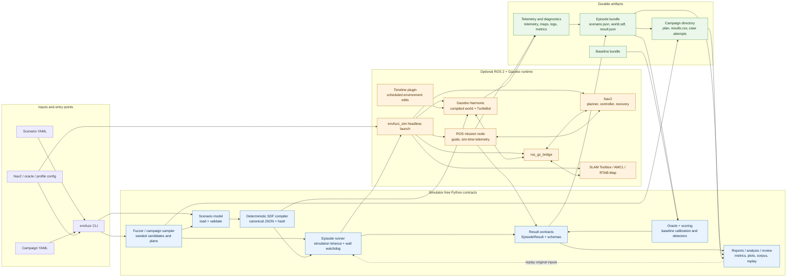

# Architecture

EnvFuzz separates deterministic scenario contracts and result analysis from the
optional ROS 2/Gazebo runtime. This keeps validation, compilation, scoring, and
campaign bookkeeping testable without a simulator while allowing live episodes
to exercise the full navigation stack.

## Main paths

- **Single episode:** `CLI` loads a scenario, `Scenario` validates it, and
  `Compile` produces the deterministic `world.sdf`. `Runner` either writes a
  simulator-free smoke bundle or starts the Gazebo path. The ROS mission node
  sends goals through Nav2, records simulation-time ground truth and estimates,
  and writes telemetry. The result bundle is then scored and rendered.
- **Fuzzing and campaigns:** `Generate` creates seeded valid scenarios or a
  frozen campaign plan. Each case uses the same episode path, while campaign
  indexing and attempt/worker bookkeeping preserve resumability and
  reproducibility.
- **Replay and review:** a saved bundle supplies the original scenario and
  runtime settings. Replay uses the same runner, and `Evidence` compares
  signatures, telemetry, maps, logs, and oracle events before a case is treated
  as reproducible evidence.

The episode deadline is based on **simulation time**. Wall-clock time is used
only by the runner/watchdog to detect startup or infrastructure stalls.

Before each Nav2 dispatch, the ROS mission converts the authored
scenario-world goal into the `map` frame using the startup map-to-robot
alignment, then checks it against the latest `/map` occupancy grid. The grid
origin is the lower-left corner of cell `(0, 0)`, rotated by the origin yaw.
Its covered area includes the lower edges and excludes the upper edges at
`origin + (width, height) * resolution`. The check reports map coverage only;
Nav2 can still fail to plan to an in-bounds goal.
