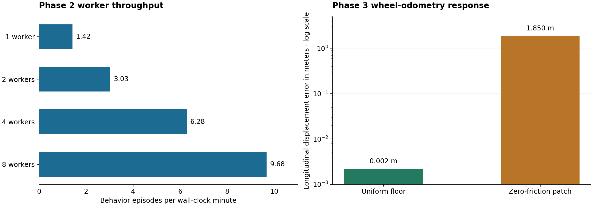

# EnvFuzz progress and verified successes

Updated November 10, 2026, in America/Chicago. Implementation is paused at the
project owner's request.

## Project status

| Phase | OpenSpec task count | Recorded outcome |
| --- | ---: | --- |
| Phase 1 MVP | 29/29 checked | CPU-only headless simulation, calibration, scoring and seeded fuzzing verified |
| Phase 2 navigation benchmark | 15/15 checked | Parallel campaigns, reports, timed edits, regression tools and classroom evaluation implemented |
| Phase 3 simulation hardening | 11/20 checked | Scripted actors, synthetic material references, additional sensors, CPU robot profiles and classroom guides verified |

Phase 3 changes are present in the project checkout. The current checkout
passes **58 simulator-free tests**.
Six live integration tests are skipped in that host-only command.

[Phase 1 evidence](phase-1-verification.md) ·
[Phase 2 evidence](phase-2-verification.md) ·
[Phase 3 evidence](phase-3-verification.md) ·
[Phase 3 task checklist](../openspec/changes/phase-3-simulation-hardening/tasks.md)

## End-to-end simulation and evaluation

| Verified capability | Evidence |
| --- | --- |
| Headless CPU runtime | ARM64 and AMD64 images run with no GPU or display mount. AMD64 execution used Apple Silicon emulation. |
| Measured LiDAR | The Phase 1 probe recorded 360 rays per scan at 5 scans per simulated second. |
| Calibration and scoring | Ten live baseline trials and 20 scored Phase 1 episodes completed. All 20 scored episodes reached their goals. |
| Durable episode outputs | Runs preserve scenarios, compiled worlds, runtime versions, timings, logs and oracle outcomes. |
| Parallel execution | The Phase 2 eight-worker configuration processed 9.68 behavior episodes per minute. |
| Reproducible timed edits | The chair fixture applied its change at exactly 3.000 simulated seconds and recorded changed LiDAR observations. |
| Organizer evaluation | The newly documented multi-room reference workflow completed all three repeats, with a median successful duration of 5.692 simulated seconds. |

The current Phase 3 package also built for both architectures and completed
separate example missions.

| Packaged image | Smoke mission outcome | Simulated mission duration |
| --- | --- | ---: |
| ARM64 | Goal reached | 4.850 s |
| AMD64 under emulation | Goal reached | 4.514 s |

These builds are local. Registry publication and a versioned release remain open.

## Phase 3 capabilities verified in the checkout

| Capability | Measured result | Guide |
| --- | --- | --- |
| Scripted actors | The initial run and public replay command each applied 40 scheduled updates at their requested timestamps. LiDAR detected the actor at both ends of the path. | [Actor guide](scripted-actors.md) |
| Bumper/contact sensing | A controlled low threshold produced a timestamped contact at 4.594 simulated seconds. | [Sensor guide](phase-3-sensors.md) |
| Cliff sensing and drop geometry | The recessed-floor fixture produced a 0.631 m downward return and a cliff detection. | [Sensor guide](phase-3-sensors.md) |
| Floor friction and motion telemetry | Longitudinal wheel-odometry displacement error measured 0.002 m on the uniform floor and 1.850 m over the zero-friction patch. IMU and wheel observations were recorded. | [Sensor guide](phase-3-sensors.md) |
| Compact vacuum profile | Both the default and compact profiles completed calibration and scored smoke episodes using their matching baselines. | [Profile guide](phase-3-profiles.md) |
| Offline sensor-fault fixtures | Three organizer-owned observation fixtures produced the expected T2 or no-event results. | [Offline checks](phase-2.md#offline-sensor-observation-checks) |
| Submission isolation | A live organizer worker used networking disabled, read-only inputs and root, private IPC, a two-CPU quota and 1536 MiB of memory. | [Classroom guide](classroom-guide.md) |
| Passive material reference | Synthetic fixtures verify transmission, stronger returns, dark-surface dropouts and thin-object ray intersections. The live navigation stack continues to consume native Gazebo ranges. | [Material guide](phase-3-materials.md) |

The compact scored smoke episode reached its goal and recorded a T3 map event.
The default scored episode reached its goal with score zero. Each used a
one-trial smoke calibration. Published comparisons require repeated calibration.

## Measured throughput and sensor response

The left panel shows the historical Phase 2 corridor benchmark on an
eight-CPU ARM64 Docker Desktop VM. Each worker had 1.5 CPUs and 1 GiB of memory.
Rates include container startup and teardown.

| Workers | Behavior episodes per minute |
| ---: | ---: |
| 1 | 1.42 |
| 2 | 3.03 |
| 4 | 6.28 |
| 8 | 9.68 |

The right panel shows the Phase 3 paired floor fixture with a two-CPU quota
and 1536 MiB of memory. Its error axis is logarithmic. The values measure
longitudinal displacement disagreement between wheel odometry and ground truth.

## Verification that improved the project evidence

The repeated Phase 3 sampling pilot completed all 18 missions after one
infrastructure retry. Replaying the six original Phase 2 failure
representatives produced 17 valid episodes and one infrastructure watchdog.
None of the 17 valid replays matched its original failure signature.
Those fixtures remain diagnostic, and the replay-agreement target remains open.

The surface probe also established the native renderer's behavior. Visual
transparency changed return intensity while range continued to report the
front panel. Task 2.1 now treats the offline material model as the normative
synthetic reference; live navigation continues to use Gazebo's native scans.

[Replay and material measurements](phase-3-verification.md)

## Verified staging work awaiting integration

An additional development snapshot is preserved with the paused work.

| Staged work | Verification performed |
| --- | --- |
| AMCL map localization | Exported a map, calibrated AMCL, then completed a scored mission with score zero. |
| Expanded unit and property suite | 68 tests passed, including Hypothesis checks for schema round-trips, deterministic compilation and valid material-edit sequences. |
| Self-contained map replay assets | Unit tests cover map export, map archiving, path restrictions and baseline identity changes when map contents change. |
| Expanded CI coverage handling | Local scripts and workflow shell syntax were checked. A complete passing instrumented integration rerun remains pending. |

The instrumented integration run recorded two infrastructure watchdog failures.
The current simulator-free suite measures 64% source coverage, below the 85%
target, so coverage has not been accepted as a completed check. The pinned
runtime camera and three-backend comparison also remain unfinished.

The paused snapshot and its verification outputs are archived under
`runs/phase3-paused/`. The archive contains pending changes for review and
resumption. It has not been applied to the checkout.

## Open work at the pause

- The complete alternative-backend comparison, final coverage and CI
  acceptance, and published release verification remain open.
- GPU camera verification, distributed execution and cross-platform
  acceptance are deferred at the project owner's request. Their OpenSpec
  checkboxes remain unchecked.
- The earlier 95% replay-agreement and 5× simulation-speed targets remain
  unmet. The benchmark reports retain the measured outcomes and timings.

The 10/20 OpenSpec count is a snapshot of checked implementation tasks.
The staging results above have not changed that count.
